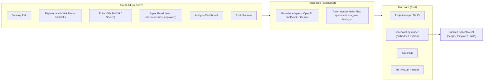

# NovelStudio — Design

NovelStudio is a desktop GUI for the [SpecNovelist](https://github.com/junov/SpecNovelist)
specification-driven novel-writing process. It drives every stage of the pipeline — project
setup, discovery interview, research, story bible, outline, abridged draft, manuscript, analysis
and publishing — through a built-in AI agent loop.

## Decisions (from the design interview)

| Topic | Decision |
|---|---|
| Platform | **Tauri 2** desktop app (Rust shell) — Windows first, cross-platform code, CI builds Win/macOS/Linux |
| UI | **Svelte 5 + SvelteKit** (SPA, `adapter-static`) + TypeScript |
| AI execution | **Built-in agent loop**: the app calls LLM APIs directly, uses SpecNovelist `AGENTS.md` + `SKILL.md` files as instructions, and exposes tools |
| Providers | OpenAI, Anthropic Claude, Google Gemini — model selectable globally and per pipeline stage |
| SpecNovelist | Git submodule at `third_party/specnovelist`; **bundled into the app** as a resource. Novel projects use the bundled copy (no per-novel submodule) |
| Python | `specnovel.py` runs on an **embedded Python runtime** bundled with the installer (falls back to system Python in development) |
| Editor | **Both**: WYSIWYG (TipTap) for prose + source mode (CodeMirror 6) toggle |
| Web research | Provider-native web search when available + app-side `fetch_url` tool |
| Autonomy | Ask before each file write / CLI run, with an "auto-approve this run" toggle |
| API keys | OS keychain (Windows Credential Manager / macOS Keychain / Secret Service) |
| Visual style | Literary/warm: serif reading typography, paper-like light theme + dark theme |
| License | MIT |

## Architecture

* **Skill execution**: the system prompt = SpecNovelist `AGENTS.md` + selected `SKILL.md`, with
  `<toolkit>` resolved to the bundled SpecNovelist path. Skill `references/*.md` are readable by
  the agent via `read_file` on the toolkit (read-only).
* **Interview Cards**: the `ask_user` tool takes structured questions (options, recommended
  default, skip) and renders them as cards rather than free chat.
* **Approvals & diffs**: every `write_file` produces a diff the user approves (unless
  auto-approve is on). Baselines are recorded with `specnovel.py accept --model <model>` so the
  `Novel-Model:` trailer is always correct.
* **Data**: every view reads the novel's Markdown files and `specnovel.py ... --json` output;
  NovelStudio keeps no shadow database. App settings live in the Tauri app-config dir.

## MVP scope

Pipeline Journey Rail · New Project Wizard · Interview Cards · Wiki-link navigation + backlinks ·
Command palette · Review & accept diffs · Agent activity feed · Book preview · Model selection ·
Analysis report visualization.

## Roadmap

Problems panel / lint gutter · Model & cost manager · Corkboard outline · Story DAG canvas ·
Timeline swimlanes · Relationship web · Triple-pane layers · Takes studio · What-if scenarios ·
Style mixer · Margin notes → editorial triage · Character voice lab · Research board ·
Graphics gallery · Focus / read-aloud mode.
