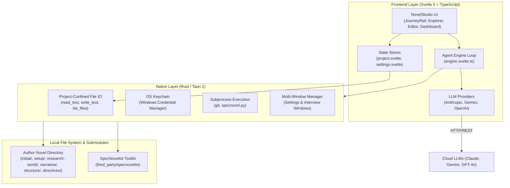

# NovelStudio Architecture Specification

## Architecture Overview
NovelStudio is architected as a lightweight local-first desktop application combining a secure Rust native shell (Tauri 2) with a reactive Svelte 5 (Runes) + TypeScript frontend.



## Tech Stack & Standards
- **Desktop Runtime**: Tauri 2 (`@tauri-apps/api` 2.x, Rust 2021 edition).
- **Frontend Framework**: Svelte 5 with modern Runes syntax (`$state`, `$derived`, `$effect`, `$props`).
- **Build Tooling & Routing**: SvelteKit with `@sveltejs/adapter-static` (SPA with `index.html` fallback) and Vite.
- **Styling**: Vanilla CSS with literary design tokens (`--bg`, `--ink`, `--paper`, Garamond & Inter typography). Zero viewport scrollbars.
- **Prose Editing**: CodeMirror 6 Markdown editor (Edit mode) and rendered Markdown preview (Preview mode) with interactive wiki-links. Zero WYSIWYG mode.
- **Testing**: Vitest (`npm test`) and Cargo (`cargo test`).
- **AI Integration**: Direct HTTP clients with streaming and tool calling for Anthropic, Google Gemini, and OpenAI.
- **Dynamic Model Discovery**: Zero hard-coded model identifiers or static whitelists in the codebase. All available models originate directly from the provider API backends (filtered by capability and sorted chronologically), guaranteeing immediate forward compatibility with new model releases.
- **Credential Storage**: Native OS Keychain via Rust `keyring` crate (Windows Credential Manager: `dev.junov.novelstudio`).

## Directory Layout
- `spec/`: Authoritative system specifications, product vision, and functional requirements.
  - `product.md`: Product vision, users, glossary, and high-level scope.
  - `architecture.md`: Architectural decisions, technical stack, and test commands.
  - `features/`: Functional requirement modules written in EARS syntax.
- `src/`: Derived frontend implementation code (Svelte 5, TypeScript, styles).
- `src-tauri/`: Derived native desktop code (Rust commands, keychain access, process spawning).
- `test/`: Derived automated test suites verifying requirement acceptance criteria.
- `third_party/specnovelist/`: Bundled SpecNovelist engine, skills, and templates.
- `third_party/specdrive/`: Bundled SpecDrive specification methodology and CLI tools.

## Mandatory Commands
- **Unit & Integration Tests**:
  ```bash
  npm test
  cargo test --manifest-path src-tauri/Cargo.toml
  ```
- **Typecheck & Production Build**:
  ```bash
  npm run build
  cargo check --manifest-path src-tauri/Cargo.toml
  ```
- **SpecDrive Conformance**:
  ```bash
  python third_party/specdrive/scripts/specdrive.py check
  ```
